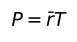
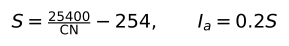
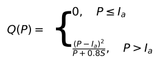
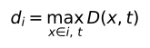
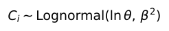
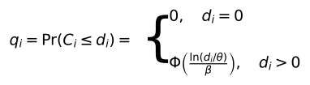
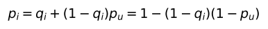

# Research and evidence for flood-induced road closures

Calculation contract: `flood-closure-1.0`. This pipeline estimates an ordinary passenger car's inability to traverse a **physical road feature during one specified event**. The research supports modeling choices; it does **not** calibrate the project's numerical defaults for Hyderabad. No event return period is inferred. Source pages and the pinned solver source were checked during implementation.

## Literature and decisions

1. **Pregnolato, M., Ford, A., Wilkinson, S. M., and Dawson, R. J. (2017).** The impact of flooding on road transport: A depth-disruption function. *Transportation Research Part D: Transport and Environment*, **55**, 67–81. [DOI: 10.1016/j.trd.2017.06.020](https://doi.org/10.1016/j.trd.2017.06.020); [author's published manuscript](https://research-information.bris.ac.uk/en/publications/the-impact-of-flooding-on-road-transport-a-depth-disruption-funct/).

   Supports using water depth to represent vehicle disruption and distinguishes delay from complete closure. Its fitted depth–speed relationship is not a probability distribution. We use a separate uncertain passability threshold; we do not claim the paper fitted our lognormal distribution or dispersion.

2. **Hackl, J., Lam, J. C., Heitzler, M., Adey, B. T., and Hurni, L. (2018).** Estimating network related risks: A methodology and an application in the transport sector. *Natural Hazards and Earth System Sciences*, **18**, 2273–2293. [DOI: 10.5194/nhess-18-2273-2018](https://doi.org/10.5194/nhess-18-2273-2018).

   Supports separating hazard, infrastructure fragility, functionality, and network consequences, including lognormal fragility practice. Its infrastructure relationships are not a locally calibrated passenger-car closure model. A probability conditional on one scenario is distinct from event frequency and annual risk.

3. **Leijnse, T., van Ormondt, M., Nederhoff, K., and van Dongeren, A. (2021).** Modeling compound flooding in coastal systems using a computationally efficient reduced-physics solver: Including fluvial, pluvial, tidal, wind- and wave-driven processes. *Coastal Engineering*, **163**, 103796. [DOI: 10.1016/j.coastaleng.2020.103796](https://doi.org/10.1016/j.coastaleng.2020.103796); [author institution record](https://research.vu.nl/en/publications/modeling-compound-flooding-in-coastal-systems-using-a-computation/).

   Supports the SFINCS backend, including rainfall, infiltration, roughness, and boundary forcing. The reduced-physics solver and its validation cases do not establish accurate urban road depths without suitable terrain, structures, boundaries, and local validation. Missing sewer capacity and river forcing remain explicit limitations.

4. **Vemula, S., Srinivasa Raju, K., Sai Veena, S., and Santosh Kumar, A. (2019).** Urban floods in Hyderabad, India, under present and future rainfall scenarios: a case study. *Natural Hazards*, **95**, 637–655. [DOI: 10.1007/s11069-018-3511-9](https://doi.org/10.1007/s11069-018-3511-9).

   Supports the importance of event rainfall, runoff, and stormwater conveyance in Hyderabad. Published online in 2018; journal issue dated 2019. The study uses SWMM, not this pipeline's SFINCS model. It does not justify treating annual rainfall as a short storm or assigning a return period to 100 mm over six hours.

5. **Bhatt, C. M., and Srinivasa Rao, G. (2018).** HAND (height above nearest drainage) tool and satellite-based geospatial analysis of Hyderabad (India) urban floods, September 2016. *Arabian Journal of Geosciences*, **11**, article 600. [DOI: 10.1007/s12517-018-3952-1](https://doi.org/10.1007/s12517-018-3952-1).

   Supports terrain/drainage connectivity, low-lying exposure, and changes in impervious cover as relevant inputs. HAND is a screening measure, not an event depth measurement or direct probability of road closure. We preserve depressions and do not use road proximity or length to invent hazard.

6. **Bárdossy, A., Seidel, J., and El Hachem, A. (2021).** The use of personal weather station observations to improve precipitation estimation and interpolation. *Hydrology and Earth System Sciences*, **25**, 583–601. [DOI: 10.5194/hess-25-583-2021](https://doi.org/10.5194/hess-25-583-2021).

   Supports station screening and validation of rainfall reconstruction, particularly at short accumulation intervals. Our IDW baseline, station-count eligibility rules, distance bounds, and held-out RMSE selection are project procedures. The paper's personal-station filtering/quantile-transformation method is not implemented or claimed as reproduced. Supplier quality control remains necessary.

## Physical and probability equations

Rainfall intensity r̄ over duration T gives the total rainfall:

Accumulation intervals are rebinned by their temporal overlap, conserving observed millimetres; unsupported time is resolved separately. Missing rainfall is never zero by implication.

SFINCS solves reduced surface-flow mass/momentum equations with rainfall and losses. The selected curve-number loss method uses retention:

Here, P, S, Iₐ and the runoff depth Q(P) are in millimetres:

The native `scsfile` stores retention in **inches** as Sᵢₙ = 1000/CN − 10; SFINCS converts it to metres. These are event losses, not a sewer model. Manning roughness controls resistance in the solver.

For a feature, use the maximum supported carriageway depth:

For a known absolute road elevation zᵢ, depth is max(0, WSE − zᵢ), with the same vertical datum. One constant elevation attribute per feature is supported; an elevation profile requires an upstream road-surface depth product.

Let the uncertain passability threshold follow:

Then the probability of closure given the modeled depth is:

This is an uncertainty assumption about one threshold per feature, **not independent pixel failures**. Increasing pixel count cannot itself increase closure probability. Unsupported features use the same per-event value pᵤ. For partial support, use

once per feature, assuming independence between known-depth and unresolved contributions. The fraction of road length with depth quantifies coverage only. It never scales pᵤ. No final road probabilities are interpolated.

## Parameter evidence register

| Setting | Initial value | Status and evidence |
| --- | --- | --- |
| Closure threshold median θ | 0.30 m | Project assumption motivated by depth-related vehicle disruption; not a fitted local threshold distribution |
| Logarithmic dispersion β | 0.35 | Uncalibrated project assumption; generic fragility form follows Hackl et al. |
| Uniform closure probability pᵤ | 0.01 per road per event | Project prior with no dependence on length, class, centrality, gaps, or cells |
| Missing rainfall | 100 mm over six hours | Synthetic scenario assumption; no return period |
| Default duration / recession | Six / six hours | Scenario settings; not estimates of local flood residence time |
| Default CN / soil group | 85 / C | Screening assumptions; NRCS method supplies the relationship, not these local selections |
| Default Manning n | 0.04 | Screening assumption; optional class mapping is also uncalibrated |
| Computational spacing | max(20 m, native DEM equivalent resolution) | Initial computational setting; can be overridden; not a terrain accuracy claim |
| Rainfall interpolation | IDW power 2, up to eight neighbours | Baseline project choice; ≥5 distinct gauges: held-out-location RMSE vs uniform mean; ≥10: eligible stable ordinary kriging |
| Rainfall support / extrapolation | Nearest observation ≤10 km / ≤2 km beyond convex hull | Configurable project bounds, not universal scientific thresholds |
| DEM and wet-area hole dimensions | At most three cells along each axis | Conservative project recovery setting; enclosed holes only |
| Numerical wetting/drying depth | 0.001 m | Solver numerical setting; active-cell maxima at/below it are reported as dry, with an explicit flag |
| Missing underground drainage | No removal | Explicit omission; can overestimate surface water |
| Missing river forcing | Local pluvial simulation | No claim of complete fluvial hazard |
| Outer/missing-terrain boundaries | Open outflow by default; closed optional | Boundary cells excluded from depth support; truncated contributing areas flagged |
| Initial water level | Dry | Explicit assumption unless a common-datum uniform level is supplied |

Land-cover mapping is versioned `worldcover-tr55-screening-v1` in `closure/sfincs.py`. WorldCover codes 10/20/30/40/50/60/70/80/90/95/100 represent tree/shrub/grass/crop/built/bare/snow/water/wetland/mangrove/moss cover. CN analogues for vegetation, cultivated, commercial, and bare surfaces use the **USDA Soil Conservation Service (1986), Urban Hydrology for Small Watersheds, Technical Release 55, second edition**, chapter 2. [USDA description](https://www.ars.usda.gov/research/software/download/?softwareid=8), [NRCS soil primer with TR-55 examples](https://www.nrcs.usda.gov/sites/default/files/2022-10/urban_soil_primer.pdf). Snow, water, wetland, mangrove CN and all cover-class roughness mappings are project screening assumptions. WorldCover does not identify connected impervious fraction. Users should supply reviewed CN/roughness maps where available.

## Data sources and recovery limits

A bare-earth DEM, event gauges/radar/satellite precipitation, event-depth rasters, and road/deck elevations are the most useful inputs. [ESA WorldCover](https://esa-worldcover.org/en/data-access) provides optional land-cover classes. **Ross, C. W., Prihodko, L., Anchang, J., Kumar, S., Ji, W., and Hanan, N. P. (2018).** HYSOGs250m, global gridded hydrologic soil groups for curve-number-based runoff modeling. *Scientific Data*, **5**, 180091. [DOI: 10.1038/sdata.2018.91](https://doi.org/10.1038/sdata.2018.91). This coarse soil product requires resampling and correct code conversion; it is not a source of road-scale terrain. [NASA IMERG](https://gpm.nasa.gov/data/imerg) is another possible rainfall product requiring event/time/unit screening.

Continuous rainfall may be reconstructed subject to support bounds. One gauge implies an explicitly flagged spatial-uniformity assumption. Categorical inputs use nearest-neighbour resampling and limited same-source nearest recovery; category codes are never averaged. Terrain recovery preserves observed elevations and depressions, fills only small enclosed holes, and never extrapolates beyond the DEM.

Flood reconstruction additionally requires user-established positive hydraulic partition IDs for a connected wet area, with levees, known dry areas, elevated barriers and disconnected basins excluded or separated. The pipeline cannot infer all barriers from a raster. With terrain, it interpolates water-surface level and subtracts terrain; without it, only small wet depth holes can be reconstructed. Larger missing coverage needs physical simulation or remains unresolved. A domain is a hydrologic polygon/DEM extent, not a road buffer.

## Validation, calibration, and sensitivity

Road-only, supplied-depth, raster recovery, rainfall conservation, strict fingerprint CSV replay, error/atomic-publication, and real solver scenarios are covered by tests. Synthetic fixtures establish software behavior, not hydrologic predictive accuracy in Hyderabad. Validate flood extents/depths against independent observations and road passability against event records before claiming local calibration. No local calibration records were provided, so exported `calibration_status` is `assumed`.

Sensitivity settings vary rainfall multipliers (0.8, 1.2), assumed CN (70, 95), threshold (0.20, 0.50 m), and uniform probability (0.001, 0.05). Rainfall/CN changes rerun SFINCS; they are not depth multipliers. These are sensitivity scenarios, not confidence intervals. Ground elevations, vertical datum, rainfall quality, hydrologic-domain truncation, missing barriers, and spatially correlated closures remain material uncertainties. The first version does not model velocity instability, scour, structural failure, administrative decisions, or drainage-system operation.

## Solver implementation references

The CPU image is pinned by digest in configuration and `environments/sfincs-image.txt`. Native input and output handling is verified against [SFINCS v2.4.0 source](https://github.com/Deltares/SFINCS/tree/v2.4.0_Galibier_release/source/src), especially `sfincs_date.f90` (FEWS integer minutes), `sfincs_ncinput.F90` (rainfall coordinates/row order), `sfincs_infiltration.f90` (SCS units), and `sfincs_ncoutput.F90` (dry maximum sentinel). See also the [official input manual](https://sfincs.readthedocs.io/en/v2.3.1/input.html). Each run checks completion, terrain, finite maxima, and prepared versus accumulated solver rainfall before publication.
